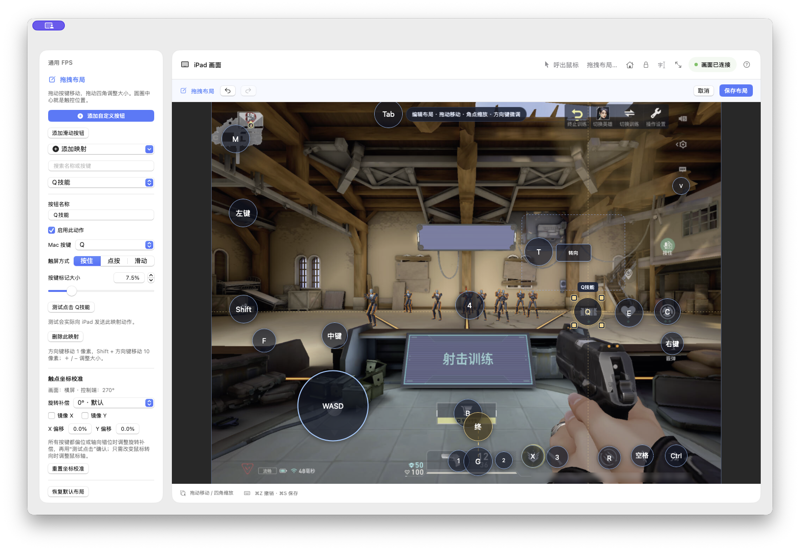
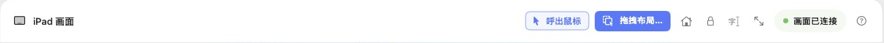
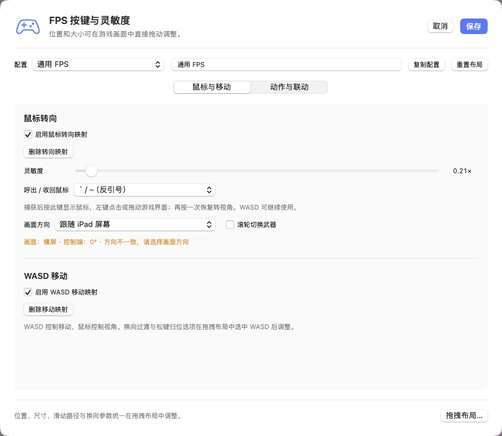
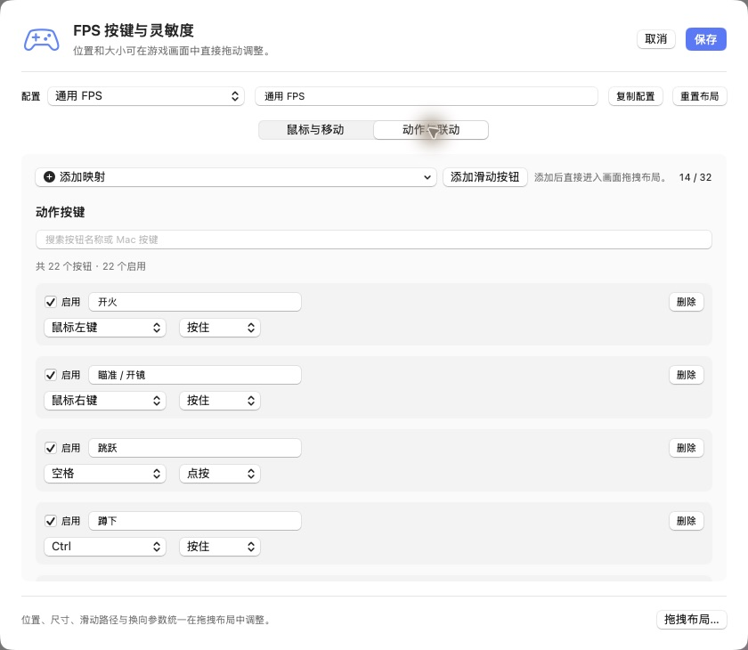
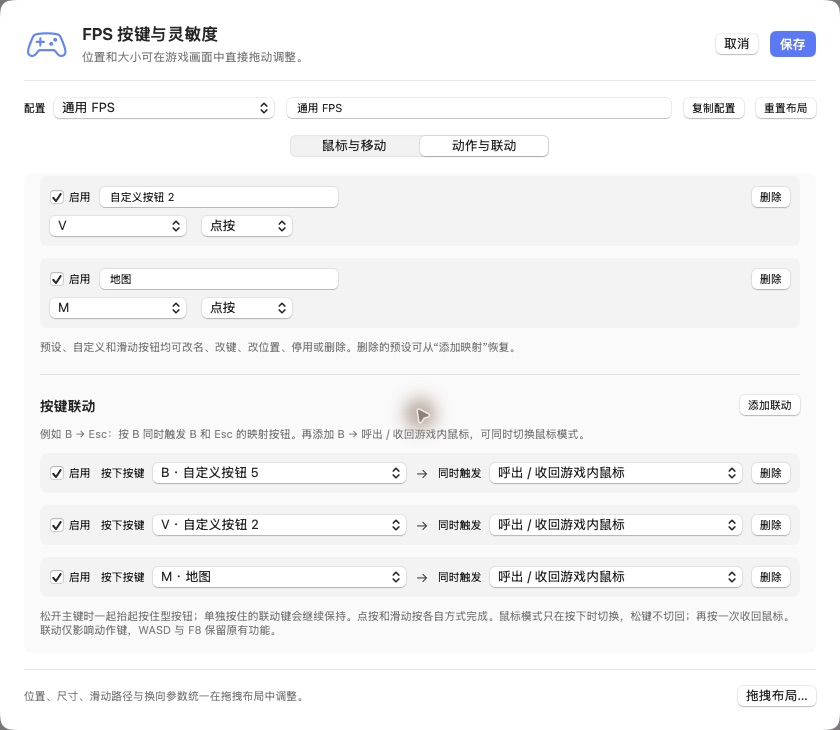
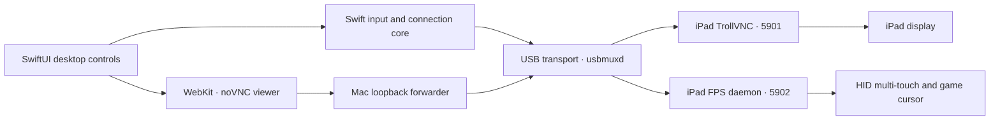

# iControl

**Control a jailbroken iPad with your Mac keyboard and mouse over USB.**

English · [简体中文](README.zh-CN.md)

A native macOS app with an integrated iPad display, editable touch mappings, and simultaneous movement, aiming, and actions for FPS games. SwiftUI provides the desktop controls; WebKit and noVNC display the game; a dedicated iPad daemon delivers multi-touch input.

[Download for Mac](https://github.com/listensay/icontrol/releases) · [Prerequisites & setup guide](docs/SETUP.md) · [中文准备与使用教程](docs/SETUP.zh-CN.md)

Mac **1.4.10 (18)** · Apple Silicon · macOS 14+ · iPad FPS daemon **1.4.1**

## In the game

The layout editor on a real game screen. This screenshot was supplied by the user, with the account identifier blurred; the application UI currently uses Chinese labels. The editable overlay belongs to iControl, and the underlying game belongs to its respective publisher.

## Features

- **One window for display and control.** USB device selection, embedded video, connection status, full screen, and an optional macOS Screen Sharing client.
- **Simultaneous game input.** WASD movement, relative mouse look, and separate touch contacts for firing, aiming, and other actions.
- **Visual layout editing.** Drag the joystick center, look region, buttons, and swipe endpoints directly over the game. Resize with corner handles; undo, redo, and save a layout draft.
- **Complete mapping management.** Add, search, rename, rebind, enable, disable, or delete presets and up to 32 custom buttons per profile. Hold, tap, and swipe are supported; deleted presets can be restored.
- **Linked actions and game cursor.** One key can trigger several mapped actions and toggle the cursor. Cursor mode lets the mouse click and drag game menus while keyboard actions remain available.
- **Profiles and recovery.** Copy profiles, keep settings drafts across tabs, reconnect to the same USB device, and release input when capture ends or the connection is lost.

## Interface

The game toolbar gives **Edit layout (拖拽布局)** a filled blue button and **Show cursor (呼出鼠标)** an outlined blue button. Both controls have matching dimensions in the toolbar and sidebar, including when the cursor label changes to its active state. Unavailable actions remain gray.

Settings separate input preferences from action mappings. Geometry and swipe paths remain in the visual layout editor.

| Mouse & movement | Actions & links |
| --- | --- |
|  |  |

View linked action settings

## Architecture

Display and FPS input travel through separate connections. The VNC viewer handles video and ordinary desktop interaction; the FPS engine sends touch snapshots directly to the daemon. The local web server and forwarding ports bind to loopback addresses.

| Component | Location | Role |
| --- | --- | --- |
| Desktop app | `Sources/IControlApp` | SwiftUI, WebKit bridge, capture, settings, installer, and Keychain integration |
| Core | `Sources/IControlCore` | USB/VNC/SSH connections, profiles, layout drafts, and multi-touch input |
| Native transport | `Sources/CTransport` | Socket and platform transport support |
| Device service | `Device/FPSDaemon` | Independent arm64 iOS service for touch injection and the device cursor |
| Viewer | `Sources/IControlApp/Resources/Viewer` | Bundled noVNC client and editable mapping overlay |
| Validation | `Tests`, `Tools/Simulator` | Protocol, input lifecycle, installation, layout, and simulator checks |

## Technical details

- **Device targets:** the Mac package targets Apple Silicon and macOS 14+. The FPS daemon targets arm64 iOS 14+ and requires a compatible jailbreak. Actual compatibility depends on the device and jailbreak environment; setup requirements are in the [guide](docs/SETUP.md).
- **Video:** the installer requests 65% display scale and 60 FPS by default. These are requested settings, not a measured frame rate or latency guarantee.
- **Input lifecycle:** actions own distinct touch contacts. Linked hold actions retain a shared target until all owners release it; tap and swipe actions complete their own gesture. WASD retains one movement contact while steering and lifts on the next input tick after all movement keys are released.
- **WASD wheel:** movement uses one continuous touch. By default, adding or releasing a direction key steers from the current position and slows as it reaches the new target. All eight directions use the same radius. Releasing both diagonal keys together lifts the touch. The layout editor can test entering W+A from either A or W while the camera turns.
- **Release behavior:** ending capture, deactivating the app, disconnecting, or exiting releases touches. The device watchdog releases contacts after 350 ms without valid input.
- **Credentials:** SSH credentials are used for the installation operation. Saved VNC passwords and FPS credentials are scoped to a device in the Mac Keychain. Classic VNC uses eight password characters; installation generates a separate control password.
- **Packaging:** the viewer, device packages, FPS daemon, required third-party sources and licenses, and both documentation languages are included in the Mac app. The package is ad-hoc signed; Developer ID signing and notarization are not configured.

## Mac builds and releases

[GitHub Actions](https://github.com/listensay/icontrol/actions/workflows/mac.yml) validates the core, checks the viewer scripts and documentation, rebuilds the bundled daemon, and packages the Mac app. Pushes and pull requests produce a downloadable build artifact. A `vMAJOR.MINOR.PATCH` tag matching the app metadata publishes a GitHub Release with **the Mac ZIP and `SHA256SUMS.txt`**. No separate iOS package or source ZIP is uploaded by this workflow.

The workflow runs on an arm64 `macos-15` runner, verifies package resources and signing, and requires no signing secrets. Build commands and the release procedure are in the [source build guide](docs/SETUP.md#build-and-release-from-source).

## License

Original Mac code is [MIT licensed](LICENSE). The independent iPad FPS daemon is **GPL-2.0-only**, with BSD notices retained for Apple HID declarations. TrollVNC 3.2-272 and noVNC retain their respective licenses; their required sources and notices ship with the app. See [third-party notices](THIRD_PARTY_NOTICES.md) and the licenses in `Sources/IControlApp/Resources`.
