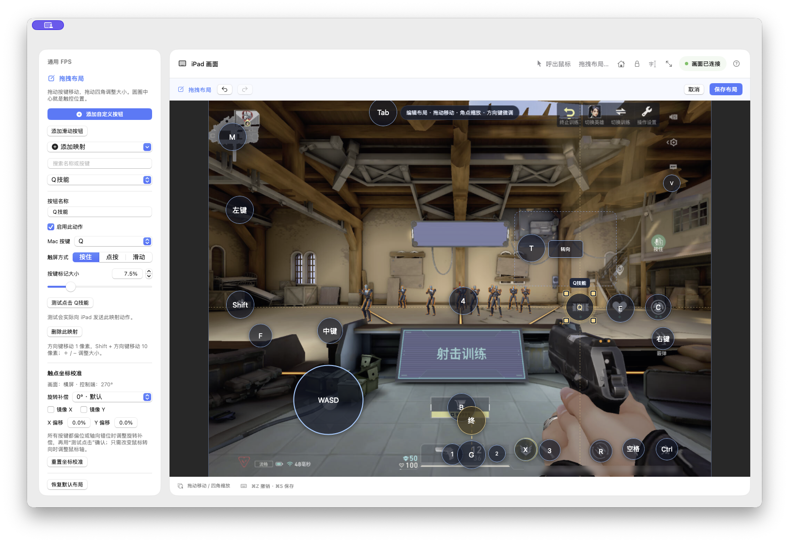
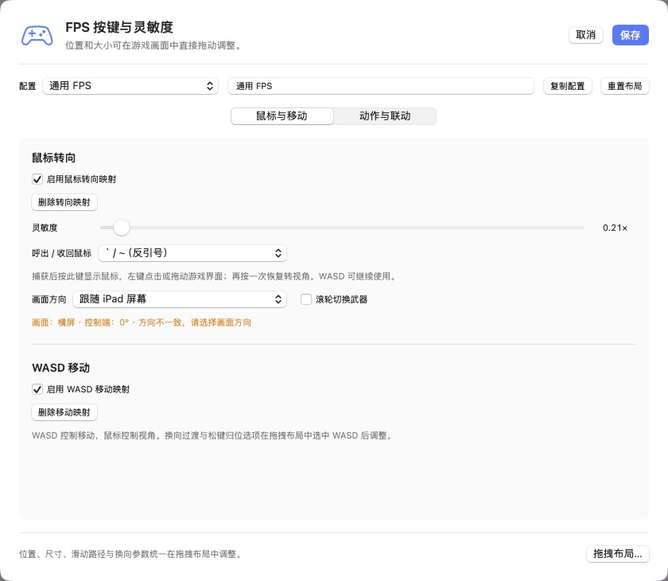
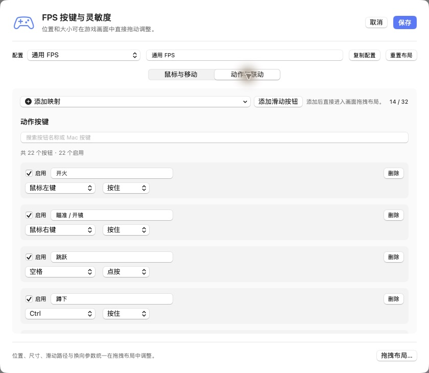
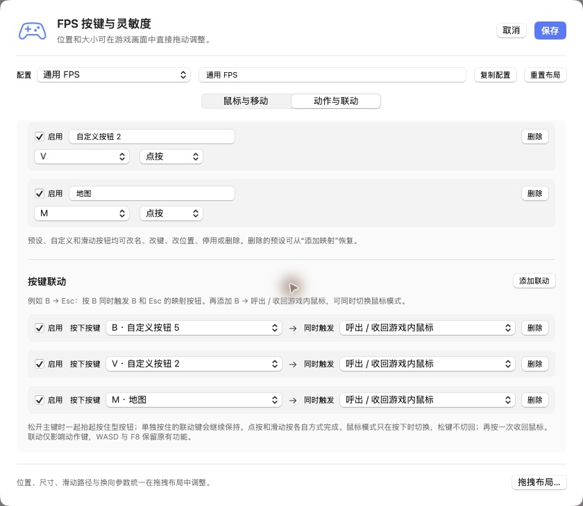
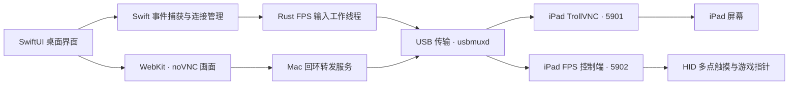

# iControl

**通过 USB，用 Mac 键盘和鼠标控制越狱 iPad。**

[English](README.md) · 简体中文

原生 macOS 应用，集成 iPad 画面、可编辑的触摸映射，以及 FPS 游戏中的移动、转向和多动作同时操作。桌面界面使用 SwiftUI，WebKit 与 noVNC 显示游戏画面，独立 iPad 控制端负责多点触摸输入。

[下载 Mac 版](https://github.com/listensay/icontrol/releases) · [前提准备与使用教程](docs/SETUP.zh-CN.md) · [English setup guide](docs/SETUP.md)

Mac **1.4.11（19）** · Apple Silicon · macOS 14+ · iPad FPS 控制端 **1.4.1**

## 游戏内画面

在实际游戏画面中编辑布局。此截图由用户提供，账号标识已模糊处理；应用界面目前使用中文。映射覆盖层由 iControl 提供，游戏内容属于相应发行商。

## 软件功能

- **画面与控制集中在一个窗口。** USB 设备选择、内嵌画面、连接状态、全屏显示，以及备用的 macOS 屏幕共享客户端。
- **多动作同时操作。** WASD 移动、鼠标相对转向，开火、开镜和其他动作使用独立触点。
- **可视化布局编辑。** 在游戏画面上直接拖动摇杆中心、转向区域、按钮和滑动终点；通过角点调整尺寸，支持撤销、重做和布局草稿保存。
- **完整的映射管理。** 添加、搜索、改名、改键、启停和删除预设与自定义按钮；每套配置最多 32 个自定义按钮。支持按住、点按和滑动，删除的预设可恢复。
- **按键联动与游戏鼠标。** 一个按键可触发多个映射动作并切换鼠标模式。呼出鼠标后可点击和拖动游戏菜单，键盘动作仍可使用。
- **配置与恢复。** 复制配置、切换 TAB 保留草稿、等待同一 USB 设备重连，结束捕获或断线时释放输入。

## 界面

画面工具栏以蓝色实心按钮突出 **拖拽布局**，以蓝色描边按钮突出 **呼出鼠标**。工具栏与侧栏中的两个按钮均保持相同尺寸；呼出后显示 **鼠标已呼出**，尺寸不变，不可用的动作保持灰色。

设置分为输入偏好和动作映射两个 TAB。几何尺寸与滑动路径统一在可视化布局编辑器中调整。

| 鼠标与移动 | 动作与联动 |
| --- | --- |
|  |  |

查看按键联动设置

## 架构

画面与 FPS 输入通过独立连接传输。Swift 捕获 Mac 事件，通过 C ABI 将事件交给 Rust 输入工作线程；手势计时与触点快照发送不让界面线程等待 USB。按键和鼠标按钮的按下、抬起是离散事件，即使发生在同一输入周期内也要保留顺序。相对鼠标位移按输入周期合并，停顿后不补播过期位移。另有读取线程处理控制端回执；VNC 画面与回环转发不经过此输入队列。

| 模块 | 位置 | 职责 |
| --- | --- | --- |
| 桌面应用 | `Sources/IControlApp` | SwiftUI、WebKit 桥接、输入捕获、设置、安装和钥匙串 |
| 核心逻辑 | `Sources/IControlCore` | USB/VNC/SSH 连接、配置、布局草稿和 Swift 输入桥接 |
| FPS 输入 | `Rust/InputCore`、`Sources/CRustInput` | Mac 端事件队列、触点映射与控制端通信，通过 C ABI 静态链接 |
| 原生传输 | `Sources/CTransport` | 套接字与平台传输支持 |
| 设备服务 | `Device/FPSDaemon` | 独立 arm64 iOS 服务，注入触摸并显示设备指针 |
| 画面客户端 | `Sources/IControlApp/Resources/Viewer` | 内置 noVNC 与可编辑映射覆盖层 |
| 验证工具 | `Rust/InputCore`、`Tools/Simulator` | Cargo 输入核心测试与 Mac 模拟工具；当前仓库不包含旧版 Swift 验证套件 |

## 技术说明

- **目标环境：** Mac 包面向 Apple Silicon 与 macOS 14+。FPS 控制端面向 arm64 iOS 14+，需要兼容的越狱环境。实际兼容性取决于设备与越狱方式，前提准备见[教程](docs/SETUP.zh-CN.md)。
- **画面参数：** 安装默认请求 65% 分辨率和 60 FPS，这是请求配置，不代表实测帧率或延迟保证。
- **输入生命周期：** 动作使用独立触点。联动按住型动作在所有触发来源松开后释放；点按与滑动各自完成手势。WASD 在连续走位时保持同一个移动触点，全部松开后在下一输入帧抬起。
- **WASD 轮盘：** 连续走位时保留同一个触点。默认开启平滑换向：加按或松开一个方向键，摇杆从当前位置转向新方向，接近目标时减速。八个方向共用同一半径，两键一起松开时直接抬指。布局编辑器可测试边转视角、边分别从 A 和 W 切入 W+A。
- **释放机制：** 结束捕获、切换应用、断线和退出都会释放触点。设备端超过 350 ms 未收到有效输入时自动释放。
- **凭据：** SSH 密码用于本次安装；保存的 VNC 密码与 FPS 凭据按设备存入 Mac 钥匙串。经典 VNC 使用前八位密码，安装时生成独立控制密码。
- **应用打包：** 内置画面客户端、设备安装包、FPS 控制端、所需第三方源码与许可证，以及中英文文档。当前采用临时签名，尚未配置 Developer ID 签名与公证。

## Mac 自动构建与版本发布

[GitHub Actions](https://github.com/listensay/icontrol/actions/workflows/mac.yml) 验证核心逻辑、画面脚本和文档，重新构建设备端并打包 Mac 应用。提交和拉取请求生成可下载的构建产物；推送与应用元数据一致的 `v主版本.次版本.修订号` 标签时，自动创建 GitHub Release，上传 **Mac ZIP 与 `SHA256SUMS.txt`**。工作流不上传独立 iOS 包或源码 ZIP。

工作流使用 arm64 `macos-15` runner，检查应用资源和签名，无需配置签名密钥。构建命令与发版步骤见[源码构建教程](docs/SETUP.zh-CN.md#源码构建与版本发布)。

## 许可

Mac 原始代码采用 [MIT 许可](LICENSE)。独立 iPad FPS 服务采用 **GPL-2.0-only**，Apple HID 声明保留 BSD 声明。TrollVNC 3.2-272 和 noVNC 保留各自许可；所需源码和声明随应用提供。详见[第三方声明](THIRD_PARTY_NOTICES.md)及 `Sources/IControlApp/Resources` 中的许可证。
