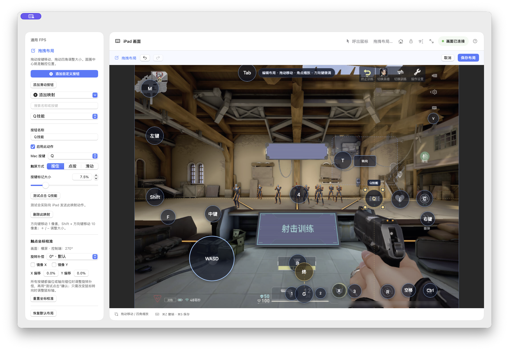

# Prerequisites and setup

[README](../README.md) · English · [简体中文](SETUP.zh-CN.md)

This guide covers installation, connection, game mappings, troubleshooting, and source builds. The [README](../README.md) describes the software and architecture. The app currently uses Chinese labels; their English meanings are included below.

## Before you start

| Item | Requirement |
| --- | --- |
| Mac | Apple Silicon, macOS 14 or later |
| iPad | A jailbroken arm64 device with a compatible iOS/iPadOS environment; the FPS daemon targets iOS 14+ |
| USB | A data cable; unlock the iPad and trust the Mac |
| Device packages | OpenSSH and PreferenceLoader installed through the jailbreak package manager |
| Installation account | An SSH account with root access or working sudo privileges |
| Game | Touch controls visible on the iPad; keep the display orientation fixed while configuring mappings |

A device observed during development was an iPad7,3 running iPadOS 17.7.11. This is not a compatibility promise for every jailbreak. Restore the jailbreak environment after rebooting before reconnecting.

## Install the Mac app

1. Download `iControl-VERSION-mac.zip` and `SHA256SUMS.txt` from [GitHub Releases](https://github.com/listensay/icontrol/releases). Put both in the same directory and verify them:

   ```sh
   shasum -a 256 -c SHA256SUMS.txt
   ```

2. Extract the ZIP and move `iControl.app` into Applications. When updating, save any layout/settings draft and quit the old app before replacing it. Saved mapping profiles remain in `~/Library/Application Support/iControl/`.
3. Open iControl. The app is ad-hoc signed and is not notarized. If macOS blocks an app you have downloaded and verified from the repository, follow the macOS **Privacy & Security → Open Anyway** flow. Do not disable system security globally.

## Configure the iPad

1. Connect the unlocked, trusted iPad with USB. Select it in **设备** (Device).
2. Open **安装 / 配置控制端** (Install / configure device service).
3. Enter the SSH account and password, then use the environment check to confirm the jailbreak and package environment.
4. Leave **安装 FPS 多点触摸控制端（含 iPad 游戏指针）** (Install FPS multi-touch service, including game cursor) enabled. Install the service and connect when the installer finishes.

The installer uses the official TrollVNC packages for video and the bundled FPS daemon for multi-touch. Device services listen on loopback ports **5901** (VNC) and **5902** (FPS). The Mac forwards them over USB; a Wi-Fi IP address is not required.

The installer backs up existing device configuration under `/var/mobile/Library/iControl/`. **恢复原配置** (Restore original configuration) in the installer restores the backed-up configuration.

SSH credentials are used for the installation operation. VNC uses a separate eight-character control password. FPS credentials and an optionally remembered control password are saved per device in the Mac Keychain.

## Connect and choose a mode

Click **连接 iPad** (Connect iPad). If authentication is required, enter the control password in the connection sheet; it is not shown in the sidebar. **断线自动重连** (Auto reconnect) waits for the same device to return. Connection status appears at the right of the game toolbar.

With **FPS 游戏模式** (FPS game mode) off:

- Left click touches the iPad; hold and move to drag.
- Scroll sends a swipe, right click returns to Home, and middle click acts as the power button.
- The toolbar provides Home, lock, full screen, and **发送文本** (Send text) for manually sending text to an iPad input field.

The app does not synchronize the iPad clipboard to the Mac.

## Set up a game layout

1. Enter the game, display its touch controls, and fix the screen orientation.
2. Turn on **FPS 游戏模式**, select a profile, and open **拖拽布局…** (Edit layout).
3. Drag WASD onto the game joystick center. Position the mouse look region over the area the game uses for turning the camera.
4. Drag each action onto the corresponding game button. Resize with corner handles. For a swipe action, place both its start and end markers.
5. Use the layout sidebar to change sizes, mouse axes, movement radius, swipe timing, or coordinate calibration. Select the screen orientation if the video and daemon report different directions.
6. Use the test actions while it is appropriate to generate touches in the game, then click **保存布局** (Save layout).



Layout shortcuts: **⌘Z** undo, **⇧⌘Z** redo, **⌘S** save, arrow keys move one pixel, Shift + arrow keys move ten pixels, and + / − resize. **取消** (Cancel) restores the configuration from before editing. A disconnection preserves the layout draft.

The WASD sidebar includes **斜走松键时重置摇杆中心** (Reset joystick center after leaving a diagonal) and movement transition settings. When enabled, releasing A while holding W+A resets only the movement touch at the configured center and pushes it forward again. This usually takes about 33–50 ms; other touch contacts remain active. Aligning the movement center with the game's joystick is essential.

## Manage buttons and links

Open **按键与灵敏度…** (Keys and sensitivity). Switching tabs retains the current draft; **保存** (Save) applies it.

| Tab | Settings |
| --- | --- |
| **鼠标与移动** (Mouse & movement) | Sensitivity, cursor shortcut, orientation, wheel weapon switching, mouse-look and WASD enable/disable |
| **动作与联动** (Actions & links) | Add, search, rename, rebind, change touch mode, enable/disable, delete, and link action mappings |

Geometry and swipe paths are edited in **拖拽布局**, not duplicated in these tabs. Each profile supports up to 32 custom buttons; deleted presets are available again in **添加映射** (Add mapping).

A **hold** keeps its contact down until release. A **tap** completes a short touch. A **swipe** completes a down/move/up sequence, including diagonal paths; releasing the key early does not interrupt the gesture. Movement, aiming, and other contacts continue independently.

In the linked-action section, add `B → Esc` to trigger both mapped keys from B. Add `B → cursor toggle` to switch mouse mode at the same time. Releasing B releases linked hold actions unless another held key still owns the same target. Tap and swipe actions complete their gestures. Cursor mode toggles only on key-down. Links apply to action keys; WASD and F8 retain their dedicated behavior.

## Capture input and use the cursor

Click the game display or press **F8** to capture input. F8 releases it again. Switching apps, disconnecting, and quitting release all touches; the daemon also releases them after 350 ms without valid input.

| Default Mac input | Game behavior |
| --- | --- |
| WASD | Move; combined keys move diagonally; the most recent opposing key takes priority |
| Mouse motion | Turn the camera |
| Left / right mouse | Fire / aim |
| Space / Ctrl / Shift | Jump / crouch / sprint |
| R / F / Z | Reload / interact / prone |
| 1 / 2 or wheel | Switch weapons |
| Backtick (\`) / tilde (~) | Toggle game cursor; configurable |
| F8 | Capture / release input |
| Esc | Available as an ordinary game action mapping |

**呼出鼠标** (Show cursor) switches to pointing mode: move to position the cursor, then left click or drag the game interface. Keyboard actions and WASD remain available. Press the cursor shortcut again to return to mouse look. The button shows **鼠标已呼出** when cursor mode is active.

The cursor displayed on the iPad requires FPS daemon 1.4.0. Upgrade older services with the installer. If device cursor rendering fails, touch input can still work.

## Troubleshooting

| Symptom | What to check |
| --- | --- |
| No USB device | Use a data cable, unlock and trust the iPad, then refresh the device list |
| Video does not connect | Restore the jailbreak after reboot; check that TrollVNC is installed and the control password is correct |
| Video works, FPS input does not | Check FPS daemon installation and credentials; inspect **诊断与日志** (Diagnostics & logs) |
| Actions touch the wrong location | Fix orientation, align markers with game controls, and use coordinate calibration in the layout sidebar |
| Movement drifts after a diagonal | Align the joystick center; check the reset option and movement transition settings |
| Cursor does not appear on the iPad | Upgrade the daemon to 1.4.0; check the cursor status message |
| Need a backup viewer | Open **系统屏幕共享** (System Screen Sharing) after USB forwarding is connected |

Frame rate, touch recognition, and sustained gameplay depend on the hardware, game, and jailbreak. Validate the layout in the actual game. The installer requests 65% video scale and 60 FPS by default; it cannot guarantee those results.

## Build and release from source

Build on an Apple Silicon Mac with macOS 14+, Apple Command Line Tools, Swift 6+, Python 3, and Node.js 22+. Run from the repository root:

```sh
./Scripts/test.sh
node Tools/verify-fps-overlay.mjs
node Tools/verify-fps-viewer-lifecycle.mjs
python3 Tools/verify-docs.py
python3 Tools/verify-release-workflow.py
./Scripts/build-app.sh
swift run -Xswiftc -enable-testing iControlValidation \
  --check-native-askpass dist/iControl.app/Contents/MacOS/iControl
```

The daemon targets arm64 iOS 14+. Its first build fetches a pinned SDK revision and a SHA-256-verified ldid binary into `work/toolchain/`. Override `ICONTROL_IPHONE_SDK` and `ICONTROL_LDID_PATH` to use an existing toolchain.

The Mac packager creates `dist/iControl.app`, `dist/iControl-VERSION-mac.zip`, and `dist/SHA256SUMS.txt`. It verifies resources, embedded package hashes, the app version, and ad-hoc signing. Both READMEs, guides, images, and license notices are included so documentation links work offline.

The [Mac workflow](https://github.com/listensay/icontrol/actions/workflows/mac.yml) runs on pushes to `main`/`master`, pull requests, version tags, and manual dispatch. Branch and pull-request builds upload an `iControl-mac` artifact with the ZIP and checksum; they do not create a release.

To publish a version:

1. Set the version and build number in `Resources/Info.plist` and `Sources/IControlApp/IControlApp.swift`. Update both READMEs and commit the changes.
2. Run the validation and package checks, then push the commit.
3. Tag that commit with the matching version, for example:

   ```sh
   git tag v1.4.5
   git push origin v1.4.5
   ```

4. Actions verifies that the tag matches the app version, builds and validates the package, uploads the Mac ZIP and `SHA256SUMS.txt` to a draft release, then publishes it after both assets are uploaded. The publish job uses GitHub's built-in token; no additional secret is required.

Only stable `vMAJOR.MINOR.PATCH` tags are accepted. A mismatched version fails before packaging. If publishing fails, rerun the workflow: an existing draft can be completed; an already published release is left intact. Do not move a published tag to another commit.

The release contains no standalone iPad asset or custom source ZIP. GitHub may still display its automatically generated source archives. `Scripts/archive-source.sh` remains an optional local developer export and is not used by the release workflow.
