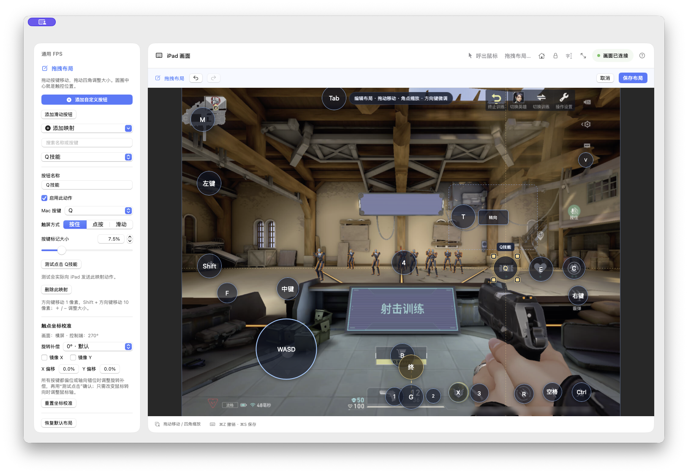

# 前提准备与使用教程

[README](../README.zh-CN.md) · [English](SETUP.md) · 简体中文

本文介绍安装、连接、游戏映射、排查和源码构建。软件功能与架构见 [README](../README.zh-CN.md)。

## 前提准备

| 项目 | 要求 |
| --- | --- |
| Mac | Apple Silicon，macOS 14 或以上 |
| iPad | 已越狱的 arm64 设备，使用兼容的 iOS/iPadOS 环境；FPS 控制端目标为 iOS 14+ |
| USB | 数据线连接，保持 iPad 解锁并信任这台 Mac |
| 设备软件包 | 通过越狱包管理器安装 OpenSSH 和 PreferenceLoader |
| 安装账户 | 具备 root 权限，或可正常使用 sudo 的 SSH 账户 |
| 游戏 | iPad 上显示触屏按钮，设置映射时保持画面方向固定 |

开发中观察过的设备为 iPad7,3、iPadOS 17.7.11，这不代表兼容所有越狱环境。iPad 重启后需要先恢复越狱再连接。

## 安装 Mac 应用

1. 从 [GitHub Releases](https://github.com/listensay/icontrol/releases) 下载 `iControl-版本号-mac.zip` 和 `SHA256SUMS.txt`，放在同一文件夹并校验：

   ```sh
   shasum -a 256 -c SHA256SUMS.txt
   ```

2. 解压后将 `iControl.app` 放入“应用程序”。更新时先保存布局和设置草稿，退出旧应用再替换。映射配置保存在 `~/Library/Application Support/iControl/`。
3. 打开 iControl。当前应用采用临时签名，尚未公证。如果 macOS 阻止打开已从本仓库下载并校验的应用，使用系统“隐私与安全性 → 仍要打开”流程，不要全局关闭系统安全保护。

## 配置 iPad 控制端

1. 用 USB 连接已解锁并信任 Mac 的 iPad，在 **设备** 中选择它。
2. 打开 **安装 / 配置控制端**。
3. 输入 SSH 账户与密码，运行环境检测，确认越狱与软件包环境。
4. 保留 **安装 FPS 多点触摸控制端（含 iPad 游戏指针）**，完成安装后连接。

安装器使用官方 TrollVNC 包提供画面，内置 FPS 控制端提供多点触摸。设备服务监听回环端口 **5901**（VNC）和 **5902**（FPS），由 Mac 通过 USB 转发，无需输入 Wi-Fi IP 地址。

安装前会备份设备配置到 `/var/mobile/Library/iControl/`。安装窗口中的 **恢复原配置** 可恢复备份。

SSH 密码用于本次安装。VNC 使用独立的八位控制密码，FPS 凭据与选择记住的控制密码按设备保存到 Mac 钥匙串。

## 连接与模式选择

点击 **连接 iPad**。需要认证时，在连接弹窗输入控制密码；左侧栏不显示密码。**断线自动重连** 会等待同一台设备返回，连接状态位于画面工具栏右侧。

关闭 **FPS 游戏模式** 时：

- 左键触摸，按住移动可拖动。
- 滚轮发送滑动，右键返回主屏幕，中键对应电源键。
- 工具栏提供主屏幕、锁屏、全屏，以及向 iPad 输入框手动 **发送文本**。

应用不将 iPad 剪贴板同步到 Mac。

## 配置游戏布局

1. 进入游戏，显示游戏触屏按钮并固定画面方向。
2. 打开 **FPS 游戏模式**，选择配置，然后点击 **拖拽布局…**。
3. 将 WASD 中心拖到游戏摇杆中心，将鼠标转向区域放到游戏用于转视角的区域。
4. 将各动作拖到相应的游戏按钮上，通过角点缩放。滑动按钮需要设置起点与终点。
5. 在布局侧栏调整尺寸、鼠标轴、推杆距离、滑动时长或触点坐标校准。如果画面与控制端方向不一致，选择相应画面方向。
6. 在适合向游戏发送触摸的时候使用测试动作，确认后点击 **保存布局**。



布局快捷键：**⌘Z** 撤销，**⇧⌘Z** 重做，**⌘S** 保存，方向键移动 1 像素，Shift + 方向键移动 10 像素，＋ / − 调整大小。**取消** 恢复进入编辑前的配置，断线会保留布局草稿。

默认开启 **平滑换向**。加按或松开一个方向键时，摇杆的横纵轴从当前位置一起移动，接近新方向时减速，约 100 ms 到位。先按 A 或先按 W，再补齐 W+A，都应指向同一条对角线；只松开 A，保持原触点转回正前。两键在一个输入周期（8.3 ms）内松开会直接抬指。需要原来的线性或即时响应时，关闭平滑换向，再调整 **WASD 推杆过渡**；时间按一个半径计算，0 ms 为即时。旧配置若自定义过渡时间，会保留手动模式。

不按方向键时，将中心十字对准游戏摇杆的静止中心，并将 **推杆距离** 设在游戏摇杆的活动半径内。**测试直行 W** 只发送 W，不转视角。**测试 W+A 加鼠标转向** 会在转视角的同时，先从 A、再从 W 切入同一个对角方向。观察游戏里的摇杆：两次斜走应指向同一个左上位置，只按 W 时应指向正上。

## 管理按钮与联动

打开 **按键与灵敏度…**，切换 TAB 保留当前草稿，点击 **保存** 后应用。

| TAB | 内容 |
| --- | --- |
| **鼠标与移动** | 灵敏度、呼出鼠标快捷键、画面方向、滚轮切换武器、转向与 WASD 映射启停 |
| **动作与联动** | 添加、搜索、改名、改键、修改触屏方式、启停、删除与按键联动 |

几何尺寸与滑动路径统一在 **拖拽布局** 编辑。每套配置最多 32 个自定义按钮，删除的预设可以从 **添加映射** 恢复。

**按住** 会持续按下直到松键；**点按** 完成一次短触摸；**滑动** 完成按下、移动、抬起，支持斜向路径，提前松键也会完成手势。移动、转向和其他触点独立响应。

在按键联动区添加 `B → Esc`，即可按 B 同时触发两个映射动作；再添加 `B → 呼出 / 收回游戏内鼠标`，可同时切换鼠标模式。松开 B 会释放联动按住型按钮，其他仍按住的来源会保留目标触点。点按与滑动各自完成手势，鼠标模式只在按下时切换。联动影响动作键，WASD 与 F8 保留专用行为。

## 捕获输入与呼出鼠标

点击游戏画面或按 **F8** 捕获输入，再按 F8 释放。切换应用、断线、退出都会释放触点，设备端超过 350 ms 未收到有效输入也会自动释放。

| 默认 Mac 操作 | 游戏行为 |
| --- | --- |
| WASD | 移动，组合键斜走，相反方向优先响应后按的键 |
| 鼠标移动 | 转视角 |
| 鼠标左 / 右键 | 开火 / 开镜 |
| 空格 / Ctrl / Shift | 跳跃 / 蹲下 / 冲刺 |
| R / F / Z | 换弹 / 交互 / 趴下 |
| 1 / 2 或滚轮 | 切换武器 |
| 反引号（\`）/ 波浪号（~） | 呼出 / 收回游戏鼠标，可修改 |
| F8 | 捕获 / 释放输入 |
| Esc | 可作为普通游戏动作映射 |

**呼出鼠标** 后，移动鼠标定位指针，左键点击或拖动游戏界面；WASD 和键盘动作仍可使用。再按鼠标快捷键恢复转视角。呼出后按钮显示 **鼠标已呼出**。

iPad 本机显示游戏指针需要 FPS 控制端 1.4.0 或更高版本。若之前用 iControl 装过 FPS 控制端，打开安装器，点 **检测环境 → 仅更新 FPS 控制端**。这个操作保留投屏、密码和游戏映射。1.4.1 在呼出期间会重启意外退出的指针进程，并恢复指针的最新位置；恢复期间仍可使用触摸输入。

## 常见问题

| 现象 | 检查方向 |
| --- | --- |
| 找不到 USB 设备 | 使用数据线，解锁并信任 iPad，再刷新设备列表 |
| 画面无法连接 | 重启后恢复越狱，确认 TrollVNC 已安装与控制密码正确 |
| 画面正常，FPS 无输入 | 检查 FPS 控制端安装与凭据，查看 **诊断与日志** |
| 动作位置偏移 | 固定画面方向，对准游戏按钮，在布局侧栏进行触点坐标校准 |
| 斜走时转动视角会偏移 | 在 1.4.9 或更高版本中，对准游戏摇杆中心，开启平滑换向，再到布局编辑器运行「W+A 加鼠标转向」测试 |
| iPad 不显示鼠标 | 若显示“指针显示进程未就绪”，用安装器更新 iPad 控制端至 1.4.1，再点“呼出鼠标” |
| 需要备用画面客户端 | USB 转发连接后打开 **系统屏幕共享** |

帧率、触摸识别和持续游戏操作效果取决于硬件、游戏和越狱环境，需要在实际游戏中确认。默认请求 65% 分辨率和 60 FPS，不能保证达到这些数值。

### 真机输入验收

在能看清摇杆、动作按钮的训练场景中验证。以下步骤同时覆盖 Mac 事件捕获、USB 传输与设备实际触点；Cargo 测试或模拟器不能测出整条链路的延迟。

1. 按住 W、加按 A，同时转动鼠标，再松开两个按键。摇杆应以同一触点转入斜向，松开后抬起；停止移动鼠标后不应延迟补转。
2. 快速转动鼠标的同时，对已映射的按钮交替短按、长按。每次短按只触发一次；松开长按不应中断其他按住的动作。切换到游戏鼠标模式拖动，再回到视角控制，之前的点击不应保持按下。
3. 按住移动键与动作键，用 F8 结束捕获；再分别通过切换应用、拔掉 USB 重试。释放或设备看门狗生效后不应残留触点。重新捕获或重连后先不要移动，确认不重放旧位移或点击。

## 源码构建与版本发布

Mac 打包需要 Apple Silicon Mac、macOS 14+、Apple Command Line Tools（macOS SDK、`xcrun`、`lipo`）、Swift 6+、稳定版 Rust（`rustc` 和 `cargo`）、Python 3.9+ 与 Node.js 22+。Rust 只是编译工具，运行打包好的应用时，Mac 与 iPad 均无需安装 Rust。在仓库根目录执行：

```sh
./Scripts/test.sh
node Tools/verify-fps-overlay.mjs
node Tools/verify-fps-viewer-lifecycle.mjs
python3 Tools/verify-docs.py
python3 Tools/verify-release-workflow.py
./Scripts/build-app.sh
```

`test.sh` 运行 Cargo 测试，构建 Rust 静态库，再用 C 接口和本地模拟控制端验证按放顺序、回执停顿和会话清理；之后构建本机控制端模拟器并链接 Swift 模拟工具。旧版 `iControlValidation` 可执行程序及其原生 askpass 检查需要 `Tests/TestSupport` 和 `Tests/IControlCoreTests`；当前仓库不包含这两个目录，跳过不代表通过。在 macOS 或 Linux 上仅测试 Rust 核心可运行 `cargo test --locked --offline --manifest-path Rust/InputCore/Cargo.toml`。

**直接使用 SwiftPM：** SwiftPM 不会运行 Cargo。首次运行 `swift build`、`swift run` 前，以及每次修改 Rust 源码后，都要先准备相同架构和配置的库。例如：`./Scripts/build-input-core.sh debug && swift build --product iControl`。对于 `swift build -c release`，先运行 `./Scripts/build-input-core.sh release`。脚本将 `libicontrol_input.a` 写入 `work/rust-input/{debug,release}/`，并通过构建标记让仅修改 Rust 的情况也能触发重新链接，无需全局安装库、设置动态库路径或另传链接参数。`test.sh` 和 `build-app.sh` 会自动完成此步骤。

设备端面向 arm64 iOS 14+，首次构建会将固定版本 SDK 和通过 SHA-256 校验的 ldid 下载到 `work/toolchain/`。可通过 `ICONTROL_IPHONE_SDK` 和 `ICONTROL_LDID_PATH` 指定现有工具链。

Mac 打包生成 `dist/iControl.app`、`dist/iControl-版本号-mac.zip` 和 `dist/SHA256SUMS.txt`，检查资源、设备包哈希、版本和临时签名。中英文 README、教程、图片与许可声明一起打包，文档链接可以离线使用。

[Mac 工作流](https://github.com/listensay/icontrol/actions/workflows/mac.yml) 在 `main`/`master` 提交、拉取请求、版本标签推送或手动运行时执行。分支与拉取请求生成 `iControl-mac` 构建产物，内含 ZIP 和校验文件，不创建版本发布。

发布新版本：

1. 同步修改 `Resources/Info.plist` 和 `Sources/IControlApp/IControlApp.swift` 中的版本与构建号，更新中英文 README 并提交。
2. 完成验证与打包检查，将提交推送至 GitHub。
3. 给该提交打上匹配版本的标签，例如：

   ```sh
   git tag v1.4.11
   git push origin v1.4.11
   ```

4. 版本标签触发 Actions 执行 `./Scripts/build-app.sh --bundled-fps`，使用已在真机验证的同一份 iPad 控制端。打包时校验控制端哈希，并逐项核对源码归档与当前提交。Mac ZIP 和 `SHA256SUMS.txt` 上传至草稿后才会公开发布。发布任务使用 GitHub 内置令牌，无需额外密钥。

只接受稳定的 `v主版本.次版本.修订号` 标签，版本不一致会在打包前失败。发布失败后可以重跑工作流：已有草稿可继续完成，已经公开的版本保持原样。不要将已发布标签移动到其他提交。

发布产物不含独立 iPad 包或自定义源码 ZIP；GitHub 仍可能显示平台自动生成的源码归档。`Scripts/archive-source.sh` 仅保留为可选的本地开发导出，不参与自动发布。
